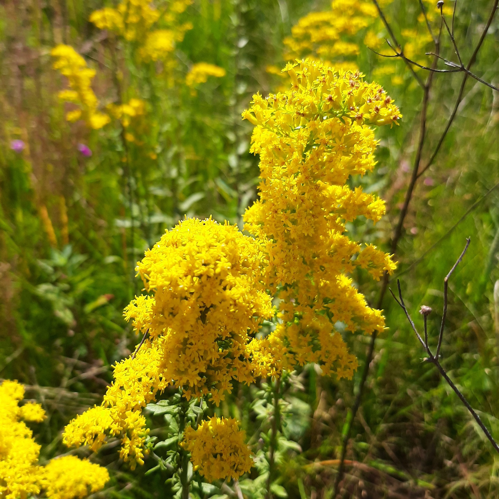

# Instructions

## English

First choose your language and delete the section of the document in the other language.

Answer the questions precisely but briefly: the questions are detailed to guide you so there are many of them. Don't waste your time repeating the course: you have all documents with you, copying their content is not valuable. To answer factual questions, you don't need to make sentences: e.g., just write "4." to answer the question "how much are 2 + 2?".

Before you begin:

1.  Type your name in the header of the document, in the author field.
2.  Run the following in the terminal (answer *No* if a message box asks you if you want to close some files):

`quarto publish gh-pages index.qmd`

During your work: render the document regularly (at the end of each question, for example) so that problems do not pile up.

At the end of the exam: save the file, make a commit and push the project to GitHub. Do not modify the project after the exam has finished.

## Français

Commencez par choisir votre langue et supprimez la partie du document rédigée dans l'autre langue.

Répondez aux questions de manière précise mais concise : les questions sont détaillées pour vous guider, c'est pourquoi elles sont nombreuses. Ne perdez pas votre temps à répéter le cours : vous disposez de tous les documents, il est inutile d'en recopier le contenu. Pour répondre aux questions factuelles, vous n'avez pas besoin de rédiger des phrases : par exemple, écrivez simplement "4." pour répondre à la question "Combien font 2 + 2 ?".

Avant de commencer:

1.  Tapez votre nom dans l'entête du document, dans le champ "author"
2.  Exécutez dans le terminal:

`quarto publish gh-pages index.qmd`

Pendant votre travail: rendez le document régulièrement (à la fin de chaque question par exemple) pour ne pas laisser les problèmes s'accumuler.

A la fin de l'examen: enregistrez le fichier, faites un commit et poussez le projet sur GitHub. Ne modifiez pas le projet après la fin de l'examen.

# English

## Estimating the number of species

*You have three inventories of 10-hectare areas of forest (approximately 5,000 trees):*

- *A: 100 species, including 20 singletons (*$S_1$*), 10 doubletons (*$S_2$*) and 3 tripletons (*$S_3$*),*
- *B: 80 species, including 30 singletons, 20 doubletons and 5 tripletons,*
- *C: 150 species, including 110 singletons, 30 doubletons and 10 tripletons.*

*Reminder of the estimator formulas, using the notation from the course:*

- $S_{J1} = S_{>0} + S_1$
- $S_{J2} = S_{>0} + 2 S_1 - S_2$
- $S_{J3} = S_{>0} + 3 S_1 - 3 S_2 + S_3$

> Quickly estimate the asymptotic richness of the forest using the jackknife estimators and the rules of @Brose2003.

A: 120 using J1

B: 120 using J2

C: 400 using J3 but very unreliable , moreover S_obs/S_estime =37.5% \< 38% the Brose threshold for J3

## Phylogenetic diversity

*The following function creates a phylogenetic tree with 3 species. The parameter `h` sets the height at which species A and B diverge.*

```{r}
tree_3sp <- function(h) {
  NewickABC <- paste0("(C:1,(A:", 1 - h, ",B:", 1 - h, "):", h, ");")
  phyloABC <- ape::read.tree(text = NewickABC)
  plot(phyloABC, direction = "downwards", srt = 90)
  axis(2)
}
# Create a tree
tree_3sp(0.5)
```

> What is the order-0 phylogenetic diversity (Faith's PD) of a community containing the three species, whose phylogenetic tree is shown in the figure?
>
> 2 (sum of the length of the branches)

> What is the possible range of values for `h`?
>
> h can go from 0 (species diverge at the root of the tree) to 1 (species are identical, or diverged so recently that they are still the same)

> What effect does `h` have on the value of PD?
>
> As PD is the length of the branches of the tree, the more the species diverged earlier the bigger is PD

> Express the value of PD in terms of `h`.

> What is the richness (taxonomic, not phylogenetic) of the community? Explain how $h$ allows us to take into account the closeness between species B and A.
>
> 3
>
> The closest h is to 1 the closest A and B species are.

> If botanists disagree on whether species B and A are synonymous and a phylogeny shows that their distance $h$ is small, suggest a method to help them reach agreement.
>
> There is no obvious way, either the phylogenetic or taxonomic arguments may prevail depending on the context. However, defining subspecies could be an option to distinguish different population in the same species.

## Lognormal distribution

*We draw two random distributions from a lognormal distribution. Their size and species richness are identical; only the standard deviation of the distribution varies.*

```{r}
library("tidyverse")
library("divent")
# Set the random seed for reproducibility
set.seed(973)
# Size and richness
the_size <- 1E6
the_richness <- 100
# Draw the first community
rcommunity(  1,
  size = the_size,
  species_number = the_richness,
  distribution = "lnorm",
  sd_lnorm = 1
) %>%
  # Give it a name
  mutate(site = "sigma = 1") %>%
  # Bind the second community data into the same tibble
  bind_rows(
    # Draw the second community    
    rcommunity(
      1,
      size = the_size,
      species_number = the_richness,
      distribution = "lnorm",
      sd_lnorm = 2
    ) %>%
      # Give it a name
      mutate(site = "sigma = 2")
  ) ->
  # Store the result
  comm_lnorm

the_size <- 600*6.25
the_richness <- 100
# Draw the first community
rcommunity(  1,
             size = the_size,
             species_number = the_richness,
             distribution = "lnorm",
             sd_lnorm = 1
) %>%
  # Give it a name
  mutate(site = "sigma = 1") %>%
  # Bind the second community data into the same tibble
  bind_rows(
    # Draw the second community    
    rcommunity(
      1,
      size = the_size,
      species_number = the_richness,
      distribution = "lnorm",
      sd_lnorm = 2
    ) %>%
      # Give it a name
      mutate(site = "sigma = 2")
  ) ->
  # Store the result
  comm_lnorm2
# Whittaker plot
autoplot(comm_lnorm2)
autoplot(comm_lnorm)
```

> What is the species richness of the observed communities?
>
> 100

> What is the abundance of the rarest species (approximately, as read from the plot) compared to the total number of trees?
>
> For sigma= 1 : around 1e+03
>
> For sigma=2 : around 1 or even 0

> What do we observe for a sample of reasonable size, say 6.25 ha with 600 trees per hectare? Draw the figure. Be careful not to overwrite the `comm_lnorm` variable when reusing the code.
>
> We observe the same pattern but for the sigma=2 curve a lot of species have no individuals to represent them which doesn't make much sense. More over the sigma=2 curve almost look linear more than lognormal.

> Plot the diversity profile of the two communities

> Which community is the most diverse? Explain this in relation to the value of $\sigma$.
>
> For the reasonable size communities. The community with sigma=1 is richer than the community with sigma=2. We can then say that it's more diverse in the sense of the diversity of order 0.
>
> Between the communities the 1st one (1E6 individuals) is more diverse because more resilient to high variance (we still observe all the species even with sigma =2)

## Pielou (1972)

*The aim of this final section is to revisit and modernise the results of @pielou1972. The data consist of abundance records for aphids of the genus* Dactynotus *on plants of the genus* Solidago *(Asteraceae), considered as their potential habitats. The diversity of each* Solidago *species is defined as the diversity of the aphid species it hosts.*

|                                    |                                    |
|------------------------------------|------------------------------------|
|  |  |

: *Dactynotus pieloui* and *Solidago nemoralis*

### Data

*We will first assess the diversity of aphids in their various habitats.*

*The data are contained in the file `Pielou1972.csv`.*

```{r}
# Read the file
read_csv('data/Pielou1972.csv') %>%
  # Replace missing values with zeros
  mutate(across(everything(), ~ replace_na(.x, 0))) %>%
  # Create an abundances object
  as_abundances() %>%
  # Set equal weights
  mutate(weight = 1) ->
  pielou_1972
# Display it
pielou_1972
```

> How many species of aphids are there?
>
> 10

> How many different plants are there?
>
> 12

*Given the experimental protocol (all species studied are in the data; there are no unobserved species), diversity will always be calculated at the sample level: the argument* `estimator = "naive"` *will be used systematically*

### Aphid diversity

> Count the number of aphid species on each plant.

> What is the maximum species richness?
>
> 8

> Calculate Simpson's diversity (not entropy).

> Which plant is the most diverse according to Simpson's measure?
>
> ```{r}
> ent_simpson(as_abundances(pielou_1972),estimator= "naive") |> mutate(diversity=1/(1-entropy))
> ```
>
> S_juncea is the most diverse with a Simson diversity of 4.88

> Plot the diversity profiles of all *Solidago* species.

> Which plant appears to be the most diverse, regardless of the order of diversity?
>
> ```{r}
> profile_hill(as_abundances(pielou_1972),estimator = "naive") |> autoplot()
> ```
>
> For all order of diversity S_juncea is the most diverse

> Check whether the curves intersect for $q>2$.
>
> ```{r}
>  profile_hill(as_abundances(pielou_1972),estimator = "naive",orders=seq(0,5,0.1)) |> autoplot()
> ```
>
> S_juncea intersects with S_gigantea for an order around 2.5

> Two profiles are flat. Explain why.
>
> Because the diversity observed in those plants is the effective diversity with all species present with the same abundance

> Partition the diversity. Summarise this partitioning in one or a few sentences. Caution: because of a bug in the published version of package divent, you can't use argument `estimator = "naive"` in the `div_part()` function. Partition the asymptotic diversity with its default estimator.
>
> ```{r}
> div_part(pielou_1972)
> ```
>
> The mean number of species by plant is 3.75 (alpha) and the total number of species in the metacommunity is estimated at 6.44 (gamma) with an effective number of habitat of 1.72 (beta) which is way less than the 12 species of plant we obtained. There is a lot of common species between all the plants.

### Niche width

*Moving forward, we will follow Pielou's approach by studying the diversity of habitats occupied by each aphid species. From this point onwards, you can no longer simply apply the course content; instead, you must extend the concepts you are familiar with to a new approach.*

*Given that each* Solidago *constitutes a distinct habitat for an aphid species, the number of habitats occupied serves as a proxy for the size of its niche. A generalist aphid will occupy more habitats (in other words, have a broader niche) than a specialist aphid. The niche breadth of each aphid species is therefore initially defined by the number of different habitats it occupies.*

*The data must be organised differently, with aphid species in rows and habitats in columns, which requires converting it to a data matrix and transposing it. As the code is rather laborious, it is provided below.*

```{r}
# Read the file
read_csv('data/Pielou1972.csv') %>%
  # Replace missing values with zeros
  mutate(across(everything(), ~ replace_na(.x, 0))) ->
  pielou_raw
# Save the names of the Soledagos
pielou_raw %>%
  pull(site) ->
  pielou_habitats
# Create a matrix
pielou_raw %>%
  # Remove the 'site' column
  select(-site) %>%
  # Convert to a matrix
  as.matrix() %>%
  # Transpose the matrix
  t() ->
  pielou_niches.matrix
# Add the column names
colnames(pielou_niches.matrix) <- pielou_habitats
pielou_niches.matrix %>%
  # Create an abundances object
  as_abundances() %>%
  # Set equal weights
  mutate(weight = 1) ->
  pielou_niches
# Display it
pielou_niches
```

*The number of habitats occupied by each aphid species can be counted using the usual diversity calculation functions, applied to this unusual dataset:*

```{r}
div_richness(pielou_niches, estimator="naive")
```

> Which aphid species is the most generalist? What proportion of habitats does it occupy?
>
> D_pieloui is the most generalist occupying 10/12 (83%) of plants

> Which species is the most specialist?
>
> D_solirostratus is the most specialist occupying only 1 plant (S_flexicaulis)

*The diversity of occupied habitats can take abundance into account.*

> Plot the aphid diversity profiles and establish the link between the actual number of *Soledago* plants and niche width.
>
> An order 0 diversity represent the number of plant inhabit by an aphid species, but an order 1 or 2 take into account the partitioning of aphid in the different hosts and to what extent this partitioning is even or not. A flatter response will indicate that the aphid species is present in all plant without preference (i.e same abundance in every plant). A huge decrease with order of diversity indicates that the aphid species inhabit way more a species than others (in abundance). Thus the niche width can also be determined by diversity of higher order.
>
> ```{r}
> profile_hill(pielou_niches,estimator="naive") |> autoplot()
> ```

> Pielou focuses solely on Shannon entropy in her article, using an archaic form known as the Brillouin formula, which makes the article very difficult to read. @Levins1968 was the first to propose measuring niche width in this way, suggesting two metrics: $-\sum_i{p_i \log(p_i)}$ and $\sum_i{\frac{1}{p_i^2}}$, where $p_i$ is the probability that an aphid is found in habitat $i$. Identify these two metrics.
>
> The first metric is Shannon entropy (log(1/pi)=-log(pi) and the second

### Niche overlap

*Pielou wants to assess niche overlap in addition to niche width. The reasoning is clearer using Hill's numbers. If the niches do not overlap at all, there is only one species per habitat, provided, of course, that there are fewer species than habitats. Conversely, if all species are completely generalist, the number of species per habitat equals the total number of species.*

> What measure reflects niche overlap? Give its value for $q = 1$.
>
> The niche overlap can be evaluated by comparing the observed number of habitat and the effective one( i.e Hill number) which corresponds to a total niche overlapping situation (not really sure about that honestly). For q=1 it's exp(H) where H is the Shannon Entropy.

# 
